<div align="center">



<br/>

<a href="https://github.com/LukiDevPro?tab=repositories"></a>
<a href="https://github.com/LukiDevPro?tab=followers"></a>

</div>

---

## About

Self-taught developer who mostly lives on the server side. I like systems that have to
stay up: game backends, bots, and the small tools that keep them running. When a project
needs a face, I'll build the frontend too — plain HTML, CSS and vanilla JS, no framework
unless it earns its place.

I enjoy the unglamorous parts: reading packet dumps, tracing a bug through a protocol,
and turning a fragile manual deploy into something repeatable.

```text
focus     ·  game server backends, Discord bots, internal tooling
languages ·  Python, C#, JavaScript
learning  ·  cleaner architecture, async Python, saner deploys
ask me    ·  anything about running and debugging live game servers
schedule  ·  night owl — most commits land well after midnight
```

Most of my work sits in private repos, so the public side of this profile is
a lot quieter than the actual workload.

---

## Tech

**Languages**

<p></p>

**Tools**

<p></p>

---

## What I build

<table>
<tr>
<td width="33%" valign="top">

**Game backends**<br/>
Custom server emulators: protocol handling, binary packet parsing, persistent player data.

</td>
<td width="33%" valign="top">

**Bots & tooling**<br/>
Discord bots, live status dashboards and the glue that keeps communities running.

</td>
<td width="33%" valign="top">

**Web apps**<br/>
PHP / MySQL apps and static sites, deployed to shared hosting without a build step.

</td>
</tr>
</table>

---

## Currently

- Building a PHP social photo-sharing app with accounts, feeds and uploads
- Maintaining a Discord bot with a live status page for a modding community
- Porting and debugging game server builds across client versions
- Learning: async Python and cleaner project structure

---

## Public work

<table>
<tr>
<td width="50%" valign="top">

### [Null's Magic Color](https://github.com/LukiDevPro/Nulls-Magic-Color)

A tiny browser tool that runs any text through a 3-stop color gradient and hands
back the ready-to-paste `<cRRGGBB>` markup. Live preview, custom color pickers,
one-click copy.

`HTML` · `Vanilla JS` · no build step

</td>
<td width="50%" valign="top">

### [magicbrawl.gg](https://github.com/LukiDevPro/magicbrawl.gg)

Static landing page for a private game server — responsive layout, EN/RU language
switch, download flow and an install walkthrough. Hand-written CSS, no framework.

`HTML` · `CSS` · `JS`

</td>
</tr>
</table>

> The rest — game server backends, Discord bots and tooling — is private.

---

## Stats

<details open>
<summary><b>GitHub activity</b></summary>
<br/>

<div align="center">


<br/>


<br/>


</div>

</details>

---

## Connect

<div align="center">

<a href="https://github.com/LukiDevPro"></a>
<a href="https://github.com/LukiDevPro?tab=repositories"></a>

<br/><br/>

<sub>Thanks for stopping by — issues and PRs on the public repos are always welcome.</sub>

</div>
